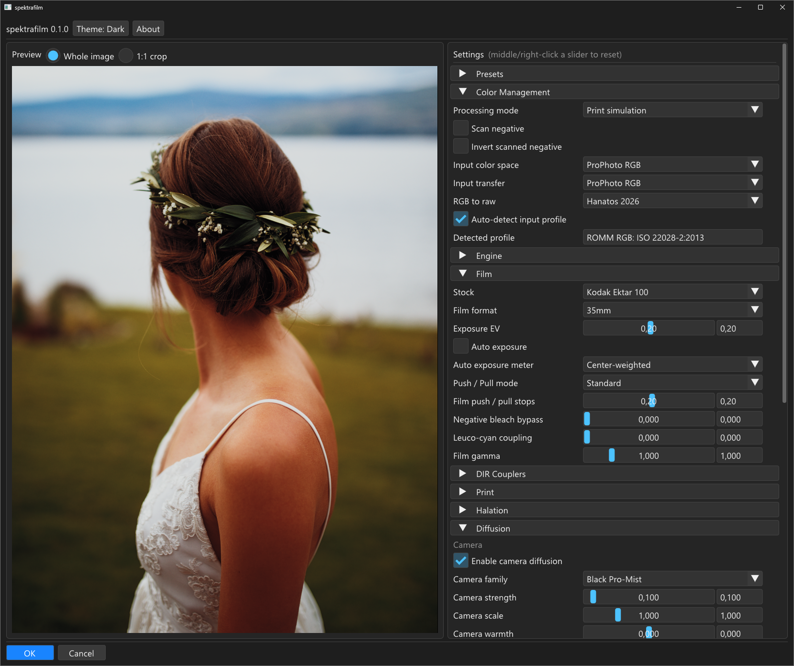

> [!NOTE]
>
> This is a 100% vibe coded project (except parts of this readme), developed on local hardware running open source models in OpenCode.

# spektrafilm-8bf
spektrafilm-8bf is a plug-in based on the spektrafilm project and its darktable implementation.
It is intended for host applications such as Affinity (by Canva) and other Adobe Photoshop-compatible applications.

Most of this project is derived from the darktable implementation of the spektrafilm project,
with additional references and code from other projects based on the spektrafilm project.
For now, the GPU-based "Effects" family of the OFX build is not implemented;
its features, such as lens distortion, vignette and bokeh, are Vulkan-only upstream.


## Build requirements

Windows 10 or 11 (64-bit), Visual Studio 2022 or 2026 (any edition, with the
"Desktop development with C++" workload), CMake >= 4.2, Python 3 on PATH, and
the submodules initialised. Then:

```powershell
git submodule update --init
cd hosts\ps8bf
.\build.ps1
```

The plug-in is the single file `dist\spektrafilm.8bf`. For installing it in
Affinity see [`hosts/ps8bf/INSTALL.md`](hosts/ps8bf/INSTALL.md); for the build
in detail see [`docs/BUILDING.md`](docs/BUILDING.md).


## GUI

GUI is made with Dear ImGui (v1.93.0, vendored). Preview on the left, settings
on the right, OK and Cancel along the bottom.



*Sample photo: [Signature Edits free raw files](https://www.signatureedits.com/free-raw-photos/).*

**Preview.** Your own image, rendered through the same pipeline as the final
render, so the box shows what OK writes back. Two view modes: *Whole image*
(supersampled, so grain and halation survive the shrink) and *1:1 crop*
(native pixel scale, drag to pan). The preview waits for the gesture to end: a
slider renders when you release the mouse button, a rolling wheel renders once
the rolling stops.

**Settings.** Collapsible groups, in pipeline order:

| Group | What it holds |
|---|---|
| Presets | Save, load and delete named looks, copy or paste a look as text, restore the factory look (Kodak Ektar 100 on Kodak Ektacolor Edge). |
| Colour Management | Processing mode, input colour space and transfer curve, auto-detect of the document profile, RGB-to-raw method. |
| Engine | LUT size and pixel pitch: accuracy against speed. |
| Film | Stock (22 profiles), film gauge, exposure, push/pull, bleach bypass, leuco coupling, film gamma. |
| DIR Couplers | The colour-coupler diffusion model: amount, inhibition, per-channel gammas. |
| Print | Paper (9 profiles), C/M/Y timing, print exposure, shadow and highlight shape, preflash, printer points. |
| Halation | Highlight boost and red scatter around bright edges. |
| Diffusion | Camera-side and print-side diffusion (Black Pro-Mist, Glimmerglass, Pro-Mist, CineBloom). |
| Grain | Film grain: amount, clumping, granularity, sub-layer scales, per-channel controls. |
| Scanner | Scanner lens blur, unsharp mask, MTF50, glare, black and white levels. |
| Camera Filters | UV and IR filtering with the cut-off wavelength. |

Every numeric setting is a slider with an editable number box: hover anything
for a tooltip naming its default and range, middle- or right-click a slider to
reset it, use the mouse wheel to nudge it. Tab and the arrows walk the
controls and Esc cancels; no key applies the settings, because OK and Cancel
are deliberately outside keyboard focus. Dark is the default theme, the
*Theme* button switches to light.

## Workflow tips

- Hover over the widgets and controls to see a helpful tooltip.
- The plug-in works best on a raw/DNG image that has had as little processing
  done to it as possible before developing.
- Adjust exposure while developing so that neither highlights nor shadows clip;
  the flatter the image going in, the more the simulation has to work with.
- For best results, develop into a 16-bit or 32-bit float image in ProPhoto RGB
  (ROMM RGB in Affinity). Float keeps the headroom; the data does not have to be
  linear, because the input is linearised with the document's own transfer curve.
- Turn on *Auto-detect input profile* in the Colour Management group. It is off
  by default, which means the input is assumed to be sRGB; with it on, the
  document's ICC profile is used instead.

## Performance

The simulation is quite slow for larger images, 30 megapixels or larger.
I have seen up to a minute of processing time after hitting the OK button in the GUI, until the result appears on the pixel layer in the editor, with a 48 megapixel image.

## Original projects used and referenced

Derived from:

- spektrafilm <https://github.com/andreavolpato/spektrafilm>
- darktable <https://github.com/darktable-org/darktable>
- darktable-spektrafilm <https://github.com/darktable-org/darktable-spektrafilm>
- spektrafilm OFX <https://github.com/chaert-s/spektrafilm-ofx>
- spektrafilm-rs <https://github.com/turbasvin/spektrafilm-rs>
- vkdt <https://github.com/hanatos/vkdt>

Built with and consulted:

- Dear ImGui <https://github.com/ocornut/imgui>
- gmic-8bf <https://github.com/0xC0000054/gmic-8bf>
- Photoshop C++ SDK headers, mirrored at <https://github.com/AdobeDocs/photoshop-cpp-sdk>

Full provenance and licences: `SOURCES.md` and `THIRD-PARTY-NOTICES.md`.

